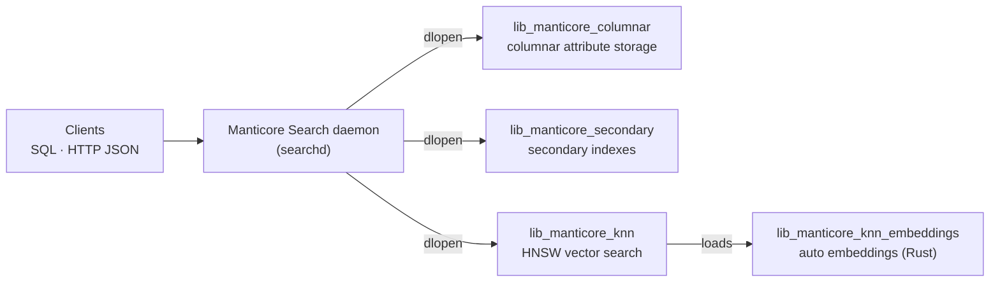

<p align="center">
  <a href="https://manticoresearch.com" target="_blank" rel="noopener">
    
  </a>
</p>

<h1 align="center">
  Manticore Columnar Library
</h1>

<p align="center">
  <b>Columnar storage, secondary indexes and KNN vector search libraries.</b><br>
  Query data that does not fit in RAM, filter it quickly, and search it by meaning.
</p>

<p align="center">
  <a href="https://github.com/manticoresoftware/columnar/actions/workflows/ci.yml"></a>
  <a href="https://github.com/manticoresoftware/columnar/releases/latest"></a>
  <a href="LICENSE"></a>
</p>

Manticore Columnar Library (MCL) is a column-oriented storage, secondary indexing and vector search library, aiming to provide decent performance with a low memory footprint at big data volumes. It consists of C++ libraries plus a Rust embeddings library:

| Feature | What it gives you | How it works | Manual |
|---|---|---|---|
| **Columnar storage** (`columnar/`) | Lower memory use on large tables: attributes stay on disk instead of in RAM | Each attribute is stored as its own column, in compressed blocks of 65,536 values. The encoding is chosen per block, and integers are packed with [FastPFOR](https://github.com/fast-pack/FastPFor) and [StreamVByte](https://github.com/fast-pack/streamvbyte) codecs | [Row-wise and columnar storage](https://manual.manticoresearch.com/Creating_a_table/Data_types#Row-wise-and-columnar-attribute-storages) |
| **Secondary indexes** (`secondary/`) | Faster filtering on attributes. Secondary indexes are on by default for numeric and string attributes; JSON attributes can be enabled with `json_secondary_indexes` | Compact learned index built on the [PGM-index](https://github.com/gvinciguerra/PGM-index) | [Automatic secondary indexes](https://manual.manticoresearch.com/Introduction#Automatic-secondary-indexes) |
| **KNN vector search** (`knn/`) | Similarity, semantic and hybrid search over `float_vector` attributes | HNSW graphs built on [hnswlib](https://github.com/nmslib/hnswlib), with L2, inner-product and cosine distance, plus optional 8-bit and 1-bit quantization | [KNN vector search](https://manual.manticoresearch.com/Searching/KNN) |
| **Auto embeddings** (`embeddings/`) | Text is turned into vectors by the library itself. Local models need no separate model service | Local models run on ONNX Runtime or [Candle](https://github.com/huggingface/candle). Remote models use the OpenAI, Voyage and Jina APIs | [Auto embeddings](https://manual.manticoresearch.com/Searching/KNN#Auto-Embeddings-%28Recommended%29) |

When used in combination with [Manticore Search](https://github.com/manticoresoftware/manticoresearch), MCL can be beneficial for those looking for:

1. log analytics combined with rich full-text search;
2. faster analytics with lower memory use on large tables. The MCL C++ libraries and Manticore Search are both written with low-level optimizations, such as SIMD, in mind; see the [benchmarks](#benchmarks) against Elasticsearch and ClickHouse;
3. semantic and hybrid search, with embeddings generated from local models or the OpenAI, Voyage and Jina APIs;
4. powerful SQL and everything else Manticore Search offers.

## Using MCL with Manticore Search



At startup, `searchd` looks for these modules in its modules directory, for example `/usr/share/manticore/modules` on Linux. `indexer` and `indextool` load the same modules. On x86_64 it prefers the `_avx512` build, then the `_avx2` build, then the baseline build, depending on what the CPU supports. If a module is missing, the daemon still runs, but that feature is unavailable.

## Getting started

The easiest way to use MCL is with Manticore Search. Since Manticore 25.0.0, the `manticore` package for Debian, Ubuntu and RHEL-based systems is a bundle that already includes `manticore-columnar-lib`. The `manticore` Homebrew formula from `manticoresoftware/tap` and the official Docker image include the MCL modules too.

**Try it in Docker:**

```bash
docker run --name manticore --rm -d manticoresearch/manticore && until docker logs manticore 2>&1 | grep -q "accepting connections"; do sleep 1; done && docker exec -it manticore mysql && docker stop manticore
```

This sandbox keeps no data. When you exit the MySQL client, the container stops and is removed.

**Install the library package on Ubuntu or Debian:**

```bash
wget https://repo.manticoresearch.com/manticore-repo.noarch.deb
sudo apt install ./manticore-repo.noarch.deb
sudo apt update
sudo apt install manticore-columnar-lib
```

If you install Manticore Search with the `manticore` package ([installation guide](https://manual.manticoresearch.com/Installation/Installation)), you already have MCL. That package provides `manticore-columnar-lib` and replaces the separate package, so do not install both.

Check that the libraries were loaded: `searchd -v` lists the columnar, secondary, knn and embeddings versions. Output from the `manticoresearch/manticore:29.9.0` image:

```
Manticore 29.9.0 58e88d5ab@26091108 (columnar 14.2.1 cb282a2@26090615) (secondary 14.2.1 cb282a2@26090615) (knn 14.2.1 cb282a2@26090615) (embeddings 1.1.1 cb282a2@26090615)
```

Then create a table that stores its attributes in columnar storage and has a vector column:

```sql
CREATE TABLE products(title TEXT, price FLOAT,
  emb FLOAT_VECTOR KNN_TYPE='hnsw' KNN_DIMS='4' HNSW_SIMILARITY='l2') ENGINE='columnar';

INSERT INTO products(id, title, price, emb) VALUES
  (1, 'red shoes', 49.9, (0.1, 0.2, 0.3, 0.4)),
  (2, 'blue shirt', 19.5, (0.9, 0.1, 0.1, 0.1));

SELECT id, title, price FROM products WHERE price > 20;
SELECT id, knn_dist() FROM products WHERE knn(emb, 2, (0.1, 0.2, 0.3, 0.4));
```

You can also make only some attributes columnar with `engine='columnar'` on those attributes. Plain tables use the `columnar_attrs` setting instead. See [how to switch between the storages](https://manual.manticoresearch.com/Creating_a_table/Data_types#How-to-switch-between-the-storages).

## Requirements and limitations

- **Platforms.** Debian-based and RHEL-based Linux and macOS on x86_64 and arm64, and Windows on x86_64. For supported distribution releases, see the Manticore [installation guide](https://manual.manticoresearch.com/Installation/Installation).
- **CPU.** On Linux and macOS, the baseline x86_64 build targets `x86-64-v2`; MSVC and clang-cl baseline builds use `/arch:AVX`. Columnar storage and secondary indexes need SSE 4.2; otherwise the daemon reports `MCL requires a CPU that supports SSE 4.2`. KNN search also needs POPCNT and reports `MCL requires a CPU that supports SSE 4.2 and POPCNT instruction`. In both cases `searchd` logs a warning and keeps running without that library. AVX2 and AVX-512 builds are used automatically when the CPU supports them. On arm64, the SIMD code runs through [SIMDe](https://github.com/simd-everywhere/simde).
- **Version matching.** Each library exposes an API number, `LIB_VERSION`. If it differs from the one the host application was built with, the library is not loaded. For example, `searchd` reports `daemon requires columnar library v29 (trying to load v28)`. With Manticore Search, upgrade or downgrade Manticore and MCL together. The `manticore` bundle package does this for you.
- **Columnar is a trade-off.** If all your attributes fit in RAM, the default row-wise storage usually gives lower latency. Columnar storage is designed for data that does not fit in memory.
- **Columnar attribute limits.** JSON attributes cannot use columnar storage; keep them row-wise in the same table. Columnar attributes cannot be changed with `UPDATE`; use `REPLACE`.
- **KNN memory.** HNSW indexes must be fully loaded into memory. Quantization reduces this footprint. Float vectors and KNN search are only supported in real-time tables.
- **Windows builds.** Windows DLLs are cross-compiled from Linux with clang. A native MSVC build of this repository is not supported, because MSVC rejects designated initializers under C++17.

## Building from source

Build from source to work on MCL or to integrate it into your own application. Packaged builds come with Manticore Search.

The C++ libraries need CMake 3.21 or newer, a C++17 compiler (GCC or Clang) and network access. During configuration, CMake downloads Manticore's forks of FastPFOR, StreamVByte, PGM-index and hnswlib from GitHub, unless you provide them in a local bundle directory (`LIBS_BUNDLE`). These are the build commands CI runs on Linux x86_64, Linux aarch64 and macOS arm64. The x86_64 job also sets `-DBUILD_TESTING=ON`, and a separate job cross-compiles the Windows x64 build from Linux:

```bash
git clone https://github.com/manticoresoftware/columnar.git
cd columnar
cmake -B build -DBUILD_TESTING=OFF
cmake --build build --config RelWithDebInfo --target columnar_lib secondary_index knn_lib --parallel
```

This produces `lib_manticore_columnar`, `lib_manticore_secondary` and `lib_manticore_knn`. Building the explicit targets skips the extra AVX2 and AVX-512 builds. A plain `cmake --build build` on x86_64 includes them.

<details>
<summary>Embeddings library, tests, and running a local build with Manticore</summary>

- **Embeddings.** The embeddings library is a Rust crate in [`embeddings/`](embeddings/). Add `-DBUILD_EMBEDDINGS_LOCALLY=ON` to build it from CMake; this requires Rust and Cargo, and CMake downloads ONNX Runtime. The `embeddings` job in [`.github/workflows/ci.yml`](.github/workflows/ci.yml) shows the full toolchain and the `cargo fmt`, `clippy` and `test` commands.
- **Tests.** With `-DBUILD_TESTING=ON`, the `knn_graphrepair_test`, `knn_multivector_slot_test` and `knn_embedding_span_test` targets build focused KNN tests that run with `ctest -R '^knn_'`. The full functional test suite runs from the Manticore Search repository against a daemon.
- **Running with Manticore.** `searchd` takes module paths from the `LIB_MANTICORE_COLUMNAR`, `LIB_MANTICORE_SECONDARY`, `LIB_MANTICORE_KNN` and `LIB_MANTICORE_KNN_EMBEDDINGS` environment variables. Point them at your build outputs. The Manticore Search repository also includes MCL as the `mcl` git submodule. Configure it with `-DMCL_LOCAL_RUNTIME=ON` to build the daemon and MCL together. See [Compiling from sources](https://manual.manticoresearch.com/Installation/Compiling_from_sources).

</details>

## Benchmarks

The Manticore team publishes comparisons of Manticore Search with columnar storage against Elasticsearch and ClickHouse on [db-benchmarks.com](https://db-benchmarks.com/). The test framework is [open source](https://github.com/db-benchmarks/db-benchmarks). The figures below are the "Relative query processing time" values shown on the site, which are based on geometric means of per-query response-time ratios ("Fast avg" results, 110,000 MB RAM limit). They compare Manticore Search 27.1.5, Elasticsearch 9.4.3 and ClickHouse 26.6.1.1193. Each figure links to the live comparison.

| Dataset | vs Elasticsearch | vs ClickHouse |
|---|---|---|
| [10M Nginx logs](https://db-benchmarks.com/test-logs10m/) | [2.79x faster](https://db-benchmarks.com/?cache=fast_avg&engines=elasticsearch_tuned_9.4.3,manticoresearch_columnar_27.1.5&tests=logs10m&memory=110000) (tuned) | [1.71x faster](https://db-benchmarks.com/?cache=fast_avg&engines=clickhouse_26.6.1.1193,manticoresearch_columnar_27.1.5&tests=logs10m&memory=110000) |
| [110M Hacker News comments](https://db-benchmarks.com/test-hn/) | [3.02x faster](https://db-benchmarks.com/?cache=fast_avg&engines=elasticsearch_tuned_9.4.3,manticoresearch_columnar_tuned_27.1.5&tests=hn&memory=110000) (tuned) | [8.99x faster](https://db-benchmarks.com/?cache=fast_avg&engines=clickhouse_26.6.1.1193,manticoresearch_columnar_tuned_27.1.5&tests=hn&memory=110000) |
| [1.7B NYC taxi rides](https://db-benchmarks.com/test-taxi/) | [2.02x faster](https://db-benchmarks.com/?cache=fast_avg&engines=elasticsearch_tuned_9.4.3,manticoresearch_columnar_27.1.5&tests=taxi&memory=110000) (tuned) | [3.16x faster](https://db-benchmarks.com/?cache=fast_avg&engines=clickhouse_26.6.1.1193,manticoresearch_columnar_27.1.5&tests=taxi&memory=110000) |

In the Hacker News test, Manticore Search also runs with a tuned configuration. Every comparison includes queries where Manticore is slower; the per-query tables show them. In the 10M logs test, Elasticsearch timed out on 2 queries, which were excluded from its score.

<details>
<summary>Charts from the original 2022 write-ups (older versions)</summary>

**10M Nginx logs, compared with Elasticsearch (tuned)**


**10M Nginx logs, compared with ClickHouse**


**110M Hacker News comments, compared with Elasticsearch (tuned)**


**110M Hacker News comments, compared with ClickHouse**


**1.7B NYC taxi rides, compared with Elasticsearch (tuned)**


**1.7B NYC taxi rides, compared with ClickHouse**


</details>

Further reading on the Manticore blog: [About columnar storage](https://manticoresearch.com/blog/mcl/), [mmap for columnar KNN rescoring](https://manticoresearch.com/blog/columnar-mmap/), [vector quantization](https://manticoresearch.com/blog/quantization/), [faster HNSW search](https://manticoresearch.com/blog/knn-hnsw-performance/) and [ONNX embeddings](https://manticoresearch.com/blog/onnx-embeddings-speedup/).

## Versions and releases

- The latest release is on [GitHub Releases](https://github.com/manticoresoftware/columnar/releases/latest). The `manticore` package and the official Docker image ship with a matching MCL version.
- Pushes to `master` that change code get a version tag automatically from [`.github/workflows/auto_version.yml`](.github/workflows/auto_version.yml), so `master` can be ahead of the latest release. The `project()` version in `CMakeLists.txt` is a placeholder that the packaging workflow replaces.
- Binary packages are built and published by the Manticore Search repository, not attached to GitHub releases here.
- For release notes, see [GitHub Releases](https://github.com/manticoresoftware/columnar/releases) and the [Manticore Search changelog](https://manual.manticoresearch.com/Changelog), where MCL updates are listed. [`Changelog.md`](Changelog.md) in this repository covers only older versions.

## Contributing, support and security

- **Bugs and feature requests:** [open an issue](https://github.com/manticoresoftware/columnar/issues/new/choose). Issues about Manticore Search behavior in general belong in the [Manticore Search repository](https://github.com/manticoresoftware/manticoresearch/issues).
- **Contributing:** this repository has no separate guide. The [Manticore Search contributing guide](https://github.com/manticoresoftware/manticoresearch/blob/main/CONTRIBUTING.md) applies. Pull requests run the checks in [`.github/workflows/ci.yml`](.github/workflows/ci.yml).
- **Security:** do not report vulnerabilities in public issues. Report them privately through [Manticore Search's private vulnerability reporting](https://github.com/manticoresoftware/manticoresearch/security/advisories/new).

## License

Manticore Columnar Library is licensed under the [Apache License 2.0](LICENSE). Binary packages also contain third-party components; see [`LICENSE-binary`](LICENSE-binary) and [`NOTICE-binary`](NOTICE-binary). [`licenses-binary/`](licenses-binary/) holds the licenses of the bundled C++ components (FastPFOR, PGM-index, hnswlib, SIMDe and StreamVByte). The Rust dependencies of the embeddings library are listed in [`embeddings/Cargo.lock`](embeddings/Cargo.lock).
